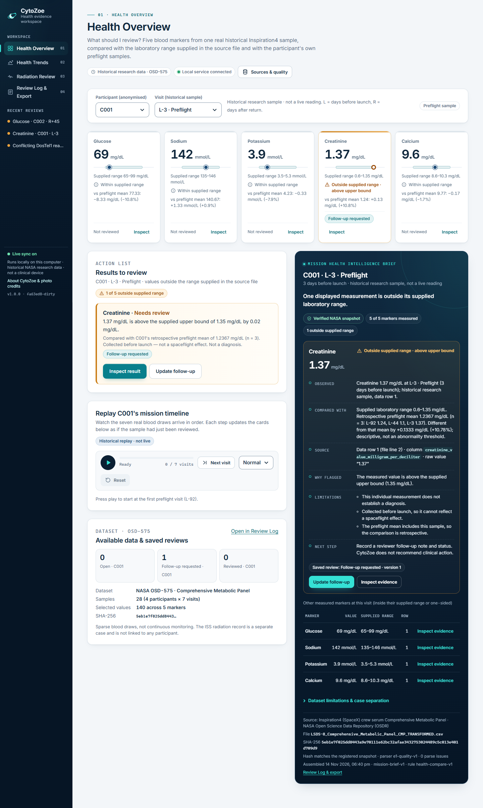

# CytoZoe — Understand the change. Keep the evidence.

**NASA Space Apps Challenge 2026 · Team CytoZoe · Challenge: [Create Health Monitoring Software for Astronauts on Space Missions](https://www.spaceappschallenge.org/2026/challenges/health-monitoring-software/)**

CytoZoe is a **local-first astronaut health evidence and review workspace**. It turns **real historical NASA biomarker samples** into understandable comparisons against a person's own baseline and the laboratory range supplied in the source. It shows a **separate ISS radiation record** with every data-quality decision visible. A reviewer can then **record, reopen and export a traceable follow-up without any internet connection**.

> **Research demonstration, not a clinical device.** All data are public, historical and anonymised. CytoZoe does not diagnose, predict illness, estimate personal radiation dose or link the two case studies causally. It shows no live vital signs.



---

## Why it matters

On a deep-space mission, the crew may have to review health information when Earth is delayed or unreachable. NASA's exploration-medicine work describes this need for independent access to health data and store-and-forward review ([NASA xEHR, 2023](https://ntrs.nasa.gov/citations/20230003216); [Earth-independent clinical decision support, 2024](https://www.nasa.gov/centers-and-facilities/ames/ames-science/ames-space-biosciences/a-clinical-decision-support-system-for-earth-independent-medical-operations/)).

A spreadsheet of measurements cannot show a reviewer:
- what changed;
- which source row supports a finding;
- where the uncertainty is;
- what follow-up was decided.

CytoZoe closes that review-workflow gap in one complete loop: **inspect → explain → save follow-up → reopen → export**.

| Challenge intent | What CytoZoe does | Honest boundary |
|---|---|---|
| Gather indicators | Imports two documented NASA CSVs locally, verified by SHA-256 | Historical data; no live sensors |
| Evaluate health | Personal preflight baseline, supplied lab ranges, actual sample history | Descriptive only; no diagnosis or severity score |
| Act on information | Saves notes and status with an audit trail; exports an HTML/JSON handoff packet | No automatic recommendation or transmission |
| Support autonomy | Every core operation runs with the internet disconnected after setup | Needs the local server process running |

## What's inside

- **4 pages:**
  - Health Overview
  - Health Trends
  - Radiation Review
  - Review Log
- **3 charts:**
  - blood marker by visit
  - sensor dose rate
  - estimated accumulated sensor dose
- **3 deterministic engines:**
  - **E1 ingestion & quality:** hashing, schema validation, conflict quarantine
  - **E2 health comparisons:** retrospective preflight mean, Δ, %Δ, strict range status
  - **E3 environment integration:** trapezoidal estimate over covered intervals only
- **1 evidence drawer:** a *Verified explanation* assistant built from fixed, source-bound templates. No language model is involved.
- **Real-time features, with no fabricated "live" data:**
  - **Radiation replay stream:** the server streams the 1,194 recorded DosTel1 readings over server-sent events, in their original order, at 300×, 1200× or 3600× speed. Rate, peak, estimated dose so far and coverage update as they arrive. Data-quality conflicts appear in an event feed at the moment the stream reaches them. Always labelled *Replay · not live*.
  - **Mission timeline replay:** steps through a participant's 7 real blood draws. The whole Overview (cards and findings) updates visit by visit, and range flags appear in an event feed.
  - **Live sync:** saving or changing a review pushes an event to every open window. Tabs refresh instantly, the sidebar's *Recent reviews* updates, and other windows get a notice. A tab with an unsaved draft is never silently rebased; it gets a 409 conflict prompt instead.
- **Conversational assistant:** suggested questions or a typed question. Typed text is routed by fixed keyword rules to the same verified templates, so there is no language model, and the typed text is never echoed into an answer.
- **Persistent reviews:** statuses OPEN / FOLLOW_UP_REQUESTED / REVIEWED, optimistic versioning (HTTP 409 on stale edits), and an audit history.
- **Local export:** a self-contained printable HTML packet plus a JSON packet, with health and environment sections kept separate. Both carry source hashes, rule versions and limitations.

Stack: React 19 + TypeScript + Vite + Recharts · FastAPI + Pydantic + pandas · SQLite (WAL, versioned migrations). The server binds to **127.0.0.1:8000** and serves the API and the built interface from one origin. It uses no CDNs, analytics or cloud APIs, and the Inter font is bundled locally.

---

## Quick start

Requirements: Python 3.11+ and Node.js 20+. Network access is needed **only once**, for dependencies and the one-time NASA data download.

### Easiest (any OS, from the project folder)
```sh
npm run setup   # one time: Python env, packages, build, fetch → verify → import NASA data
npm run dev     # development: API + interface together → http://127.0.0.1:5173
npm start       # demo / offline: built app on one port → http://127.0.0.1:8000
```
`npm run data` re-downloads and imports the NASA files; `npm test` runs the backend tests, typecheck and component tests.

### Windows (PowerShell)
```powershell
.\scripts\setup.ps1      # venv + backend deps, npm ci + build, fetch → verify → import NASA data
.\scripts\start.ps1      # http://127.0.0.1:8000
```

### macOS / Linux
```sh
sh scripts/build_local.sh
sh scripts/start.sh      # http://127.0.0.1:8000
```

### Manual steps (any OS)
```sh
python -m venv .venv && <activate it>
python -m pip install -e "./backend[dev]"
cd frontend && npm ci && npm run build && cd ..
python scripts/fetch_data.py --all            # one-time, allow-listed NASA HTTPS hosts only
python scripts/verify_data.py --strict        # SHA-256 + schema + counts
python scripts/import_data.py --all           # atomic, idempotent import into runtime/cytozoe.sqlite
uvicorn app.main:app --app-dir backend --host 127.0.0.1 --port 8000
```

Development with hot reload: run the uvicorn command above, then `cd frontend && npm run dev` (http://127.0.0.1:5173, which proxies `/api` to port 8000).

Once data is imported, **the raw CSVs are no longer needed**: the app reads only from the local SQLite database. The repository does not ship raw files. Running `fetch_data.py` recreates them byte-for-byte, and the manifest proves that by hash.

### Tests
```sh
cd backend && python -m pytest -q                 # 33 tests: engines, API, streams, on the real pinned NASA snapshots
cd frontend && npm run typecheck && npm test      # strict TypeScript + component tests
cd frontend && npx playwright test                # 12 E2E specs (uses installed Edge/Chrome; set PW_CHANNEL)
```
The real-data backend and E2E tests need `data/raw/` staged (`python scripts/fetch_data.py --all`). Without it they are **skipped, not faked**. See [docs/TEST_REPORT.md](docs/TEST_REPORT.md) for the latest run.

---

## Datasets

The original one-page brief named four candidate data sources. The final MVP uses **two** of them, by design: they are the only ones that are public, real, documented, and honest to use without inventing data. All four are documented here so the team and judges can see exactly what was used and why.

### 1. NASA OSD-575: Inspiration4 Comprehensive Metabolic Panel (**USED: health case**)

| Field | Value |
|---|---|
| Provider | NASA Open Science Data Repository (OSDR) |
| Study page | https://osdr.nasa.gov/bio/repo/data/studies/OSD-575 |
| File | `LSDS-8_Comprehensive_Metabolic_Panel_CMP_TRANSFORMED.csv` |
| Download URL | https://osdr.nasa.gov/geode-py/ws/studies/OSD-575/download?source=datamanager&file=LSDS-8_Comprehensive_Metabolic_Panel_CMP_TRANSFORMED.csv |
| SHA-256 (verified 14 Nov 2026) | `5eb1e7f025dd8443a9e70111e62bc32afae3432753024489c5c013e401d709d9` |
| Size | 8,506 bytes · UTF-8 with BOM · 28 data rows × 58 columns |
| Licence | Study page lists **CC0-1.0**; citation preserved |
| Subjects | 4 anonymised Inspiration4 (SpaceX, 2021) crew codes: C001, C002, C003, C004 |
| Visits (7 each) | L-92, L-44, L-3 (days **before launch**), R+1, R+45, R+82, R+194 (days **after return**) |
| Sample label | `Sample Name`, e.g. `C001_serum_L-3` |
| Markers imported | Glucose (mg/dL), Sodium (mmol/L), Potassium (mmol/L), Creatinine (mg/dL), Calcium (mg/dL) |
| Columns per marker | `{marker}_value_{unit}`, `{marker}_range_min_{unit}`, `{marker}_range_max_{unit}` |
| Imported values | 140 of 140 present (28 samples × 5 markers), 0 parse issues |
| Not used | The other 14 CMP analytes; race-based eGFR columns are deliberately excluded |

Verified facts used as acceptance fixtures:
- **C001 L-3 creatinine:** 1.37 mg/dL vs. a supplied upper bound of 1.35 mg/dL. This is outside the supplied range and was collected **before launch**. The retrospective preflight mean is (1.24 + 1.10 + 1.37)/3 = 1.236667, with n = 3.
- **C001 R+1 glucose:** 90 mg/dL vs. a preflight mean of (83 + 80 + 69)/3 = 77.3333. That gives Δ = +12.6667 (+16.38%), within the supplied 65–99 range.
- **C003 creatinine:** the supplied bounds change between pre- and post-flight samples (0.6–1.35 → 0.5–1.1). The chart therefore draws per-visit bounds instead of one band.

Suitable for descriptive personal comparison and source-range review. **Not** suitable for continuous monitoring, disease labels, prediction, or exposure–health analysis: four people are not a validation cohort.

### 2. NASA RadLab DosTel1: ISS Columbus, 1 March 2022 (**USED: separate environment case**)

| Field | Value |
|---|---|
| Provider | NASA OSDR RadLab |
| API documentation | https://visualization.osdr.nasa.gov/radlab/gui/data-api/ |
| Instrument | https://visualization.osdr.nasa.gov/radlab/gui/knowledgebase/DosTel1 (ISS Columbus module; documented nominal cadence 300 s) |
| Download URL | https://visualization.osdr.nasa.gov/radlab/api/?instrument_id=DosTel1&timestamp%3E=2022-03-01&timestamp%3C2022-03-02&absorbed_dose_rate&format=csv |
| Local file name | `radlab_DosTel1_2022-03-01.csv` |
| SHA-256 (verified 14 Nov 2026) | `d3f64e7f483c3ae2f08bb5e6633bae5091e661a988c434205ce6bb78c050f7e1` |
| Size | 52,555 bytes · 1,202 rows · columns `timestamp,instrument_id,absorbed_dose_rate` |
| Unit | µGy/hour (absorbed dose rate at the instrument) |
| Time range | 2022-03-01T00:00:00 → 2022-03-01T23:58:34 (no timezone suffix; shown exactly as exported) |
| Cadence observed | irregular: median 89 s, maximum 213 s |
| Licence | Publicly accessible via the NASA API. **Redistribution terms not verified**, so the raw file is not committed |

**Data-quality finding (real, in the source):** 4 timestamps appear twice with **different** rates:

| Timestamp | Data row → rate (µGy/hour) |
|---|---|
| 09:15:00 | 464 → 10.1122485512821 · 465 → 9.853933 |
| 09:20:00 | 468 → 5.61126966666667 · 469 → 4.474783 |
| 18:25:00 | 946 → 5.46090767412141 · 947 → 5.312235 |
| 18:30:00 | 950 → 6.03754233333333 · 951 → 5.625719 |

All 8 rows are kept for audit and **quarantined** from analysis. They are never averaged, summed or first-picked. This leaves 1,198 unique timestamps and 1,194 accepted rows. The resulting estimate is **296.04 µGy at the sensor over 23 h 44 min 49 s of covered time (99.04% of the recorded span)**, from 1,189 included intervals with 4 excluded. The estimate is *not* a personal, organ or effective dose, and there is no Gy→Sv conversion and no limit comparison.

### 3. NASA GLDS-174: gene-expression context (**NOT USED: deferred to future work**)

Named in the original brief as molecular context. It was excluded from the MVP because:
- it is not person-matched to the CMP samples;
- it adds no reviewable measurement to the core workflow;
- the PRD (v2.0 §0.4) forbids integrating it in P0.

It remains a candidate for future research only. No GLDS-174 data was downloaded or used.

### 4. BIDMC dataset: optional validation (**NOT USED: explicitly excluded**)

Named in the brief as optional validation data. It was excluded because:
- it is a non-astronaut clinical dataset;
- using it would invite misleading "validation" claims for software that has no trained model;
- the PRD (v2.0 §0.4) explicitly excludes BIDMC from the competition application.

No BIDMC data was downloaded or used.

### Why the two used datasets are never joined
The OSD-575 samples come from Inspiration4 (2021). The DosTel1 record comes from the ISS on 1 March 2022. They are different missions, times and people, so there is **no** person-level dose. The API rejects attempts to combine them (`CROSS_CASE_LINK_REJECTED`), and the database enforces that environment reviews never carry a participant. Pairing exposure with physiology is future work, and it needs matched personal dosimetry and onboard measurements.

Full provenance: [data/manifests/sources.json](data/manifests/sources.json) · [docs/SOURCES.md](docs/SOURCES.md) · [docs/DATA_DICTIONARY.md](docs/DATA_DICTIONARY.md)

---

## Security and privacy (local-only)

- Binds to `127.0.0.1` by default. The host-header allow-list and an origin check block cross-site writes, and there is no permissive CORS.
- **The app makes no external network requests at runtime.** NASA data is fetched only by the setup CLI, from allow-listed HTTPS NASA hosts.
- CSV import accepts only the two documented schemas: ≤ 10 MB, UTF-8, strict columns. Import is atomic and keeps the last good data on failure.
- Notes are escaped everywhere, including the HTML export. The CSP blocks inline scripts. Logs never contain note text or file contents.
- No secrets or API keys exist or are needed. `runtime/` (SQLite and notes) is gitignored.
- No real PHI is involved, and no HIPAA, clinical or security certification is claimed. See [docs/SECURITY.md](docs/SECURITY.md).

## Documentation

| Document | Purpose |
|---|---|
| [docs/IMPLEMENTATION_STATUS.md](docs/IMPLEMENTATION_STATUS.md) | P0/P1 requirement ledger |
| [docs/TEST_REPORT.md](docs/TEST_REPORT.md) | Commands, results, visual & accessibility findings |
| [docs/ARCHITECTURE.md](docs/ARCHITECTURE.md) | Engines, API, schema, data flow |
| [docs/SOURCES.md](docs/SOURCES.md) / [docs/DATA_DICTIONARY.md](docs/DATA_DICTIONARY.md) | Provenance and fields |
| [docs/KNOWN_LIMITATIONS.md](docs/KNOWN_LIMITATIONS.md) | What CytoZoe cannot do |
| [docs/DEMO_SCRIPT.md](docs/DEMO_SCRIPT.md) | Three-minute judge demo |
| [docs/SUBMISSION.md](docs/SUBMISSION.md) | Space Apps submission text and checklist |
| [docs/SECURITY.md](docs/SECURITY.md) | Threat model and safeguards |

## Credits

Team CytoZoe (NASA Space Apps 2026). Data: NASA OSDR (OSD-575) and NASA OSDR RadLab (DosTel1). The code was written with the help of an AI coding assistant (Claude Code). The delivered app itself uses no AI model at runtime. Check the 2026 Space Apps AI-disclosure rules before submitting.

Code licence: see [LICENSE](LICENSE). NASA data remain subject to their providers' terms.
