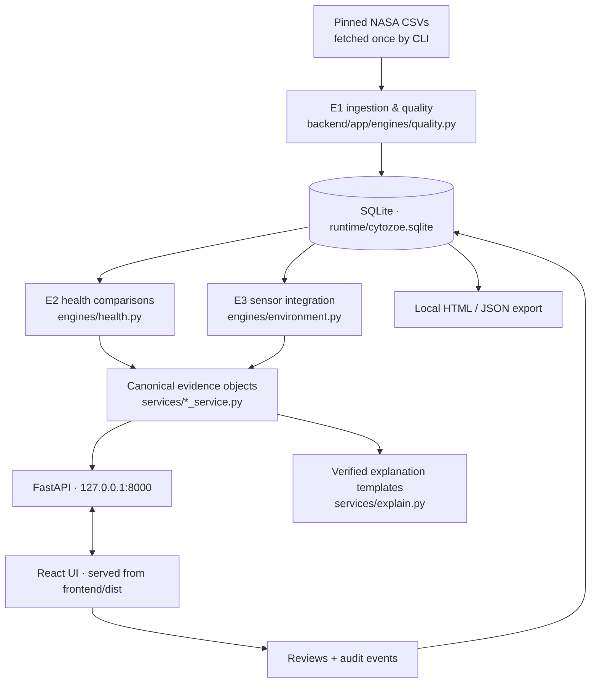

# Architecture

## Layers
| Layer | Location | Notes |
|---|---|---|
| Adapters / E1 | `backend/app/engines/quality.py`, `services/importer.py` | pandas reads with `dtype=str` (nothing coerced silently); strict headers; NA→null; nonfinite rejected; source row kept; conflicts quarantined; atomic + idempotent import by SHA-256 |
| E2 | `engines/health.py` | baseline = mean of finite preflight values (n ≥ 2); Δ, %Δ (B ≠ 0); strict range rule; rule `health-compare-v1` |
| E3 | `engines/environment.py` | trapezoid on adjacent accepted readings; exclude Δt ≤ 0, Δt > 300 s, or any excluded event strictly inside; rule `env-integration-v1` |
| Evidence | `services/health_service.py`, `services/environment_service.py`, `services/evidence.py` | one canonical object per finding with source row/column/hash, formulas, limitations, review state. The frontend never recalculates |
| Reviews | `services/reviews.py` | evidence frozen into `findings` at first review; `reviews.version` optimistic lock → 409; `review_events` audit trail |
| Export | `services/export.py` | JSON (`allow_nan=False`) and self-contained escaped HTML |
| API | `app/api/routes.py`, `app/main.py` | structured errors `{code,message,details}`, trusted hosts, origin check, CSP, request-ID logging without bodies |
| UI | `frontend/src/{pages,components,charts,api,styles,lib}` | tokens in `styles/tokens.css`; URL holds selection state; one shared drawer |

## Stable identifiers
- Health evidence: `osd575-cmp:<Sample Name>:<marker>` (for example `osd575-cmp:C001_serum_L-3:creatinine`)
- Environment: `radlab-dostel1:summary`, `radlab-dostel1:conflict:<source timestamp>`
- Radiation observations: `radlab-dostel1:row<data row>`

The IDs come from source-row identity. Each saved finding also stores the dataset SHA-256 and the rule version, so a later dataset version cannot silently rewrite an exported report.

## API
| Method | Path | Purpose |
|---|---|---|
| GET | `/api/status` | version, git build, schema version, DB state, loaded datasets, assistant mode |
| GET | `/api/datasets` | provenance + quality reports |
| POST | `/api/import` | multipart CSV (≤ 10 MB, documented schemas only) |
| GET | `/api/participants` | participants with ordered visits |
| GET | `/api/health?participant=&sample=` | five evidence cards + findings to review |
| GET | `/api/health/trend?participant=&marker=` | all visits, baseline, bounds consistency |
| GET | `/api/environment` | segments, excluded events, conflicts, integration, raw-row explorer (rejects `participant`) |
| GET | `/api/evidence/{id}` | one canonical evidence object |
| POST | `/api/explain` | `{evidence_id, question_id}` (enum only) → verified explanation |
| GET/POST | `/api/reviews` | list with filters / idempotent create per finding |
| GET/PATCH | `/api/reviews/{id}` | detail with history / update with `version` (409 on conflict) |
| GET | `/api/export?format=json\|html` | downloadable packet |
| GET (SSE) | `/api/events` | live change feed: `review.created`, `review.updated`, `dataset.imported` (note text never broadcast) |
| GET (SSE) | `/api/replay/environment?speed=&start=` | paced stream of the recorded DosTel1 readings + quality events; `meta` / `frame` / `end` events; labelled REPLAY |
| GET | `/api/replay/health?participant=` | visit-by-visit frames with range flags and a prospective baseline (only visits ≤ k) |

| GET | `/api/mission/brief?participant=&sample=&mode=historical` | MissionBriefV1, assembled only from canonical evidence (`services/mission_brief.py`, `app/schemas.py`) |
| GET | `/api/healthz` · `/api/readyz` | liveness (no DB) · readiness (DB, migrations, verified datasets; `services/runtime.py`) |

## Trust & provenance (backend v3)
`importer.import_bytes` refuses any bytes whose SHA-256 is not registered in `data/manifests/sources.json`. `datasets.provenance` (migration 0002) is reconciled against the manifest at startup. `health_service.verified_dataset` makes the NASA endpoints serve only `NASA_PINNED_VERIFIED` rows. Full contract: [API_CONTRACT.md](API_CONTRACT.md).

## Real-time design
- `services/live.py` holds a thread-safe in-process broker (asyncio queues; `call_soon_threadsafe` from sync handlers) plus the replay generator.
- Replays never generate values. They emit stored source readings and E3 cumulative values in source-time order, at `speed`× wall time.
- Each tab sends an `X-CytoZoe-Client` id, so events can be marked as coming from another window.

## Design system
v2 uses a warm neutral canvas, a light sidebar, Source Serif 4 headings with Inter body text (both bundled), and a clay action colour. Colour roles are separate: clay = actions, slate-blue = data, amber = needs review, green = saved. This replaces the PRD §5 navy/teal palette at the team's request; all the functional and accessibility rules from §5 still apply.

OpenAPI: http://127.0.0.1:8000/api/docs (local).

## Database schema
See `backend/migrations/0001_initial.sql`. Tables: `datasets`, `import_runs`, `health_observations`, `radiation_observations`, `findings`, `reviews`, `review_events`. `PRAGMA user_version` tracks the migration level. SQLite runs in WAL mode with foreign keys enforced. CHECK constraints keep environment reviews free of participant IDs.

## Deviations from the PRD layout
- E2E specs live in `frontend/e2e/` (not `tests/e2e/`) so they resolve the frontend's installed `@playwright/test`.
- Migrations are plain versioned SQL files applied by `app/db.py`, not Alembic. This is the "equally reproducible tracked migration strategy" the PRD allows.
